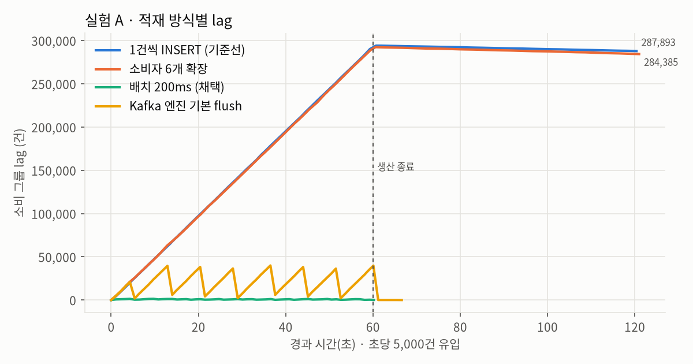
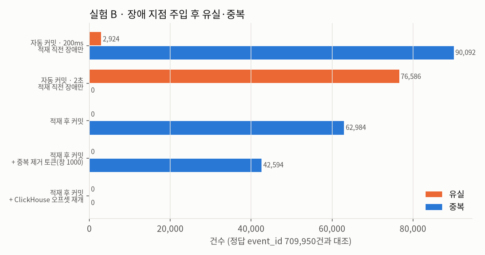
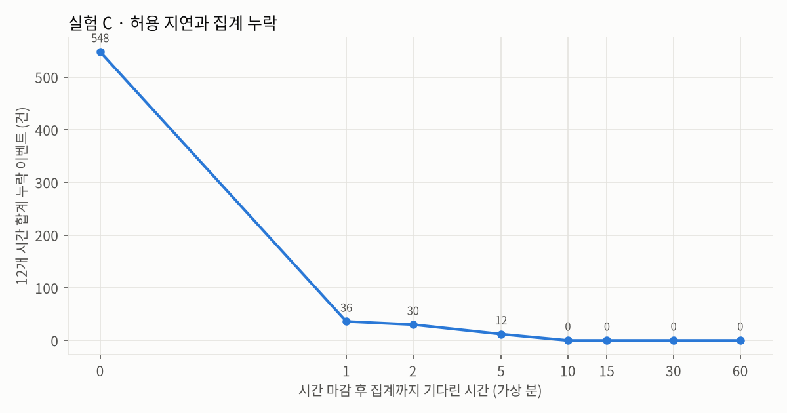

# search-log-pipeline

공개 검색 클릭 로그(MS MARCO ORCAS, 1,882만 쌍)를 실시간 이벤트로 재생해 **수집 → 검증·정제 → 적재 → 지표**까지 잇는 로그 파이프라인 연습 프로젝트입니다. 세 가지 장애를 **일부러 재현**하고, 대안을 같은 조건에서 측정해 비교한 기록을 함께 남겼습니다.

> 진행 중: 1·2단계와 장애 재현 실험 3건 완료. Airflow 지표 DAG, 어뷰징 탐지 채점, 관측(Grafana)은 다음 단계입니다.

```
ORCAS(tsv.gz) ─▶ 재생기 ─▶ Kafka search-events (6 파티션, key=user_id)
                              │
                              ▼
                     Python 수집기: 검증·정규화 ─▶ ClickHouse events (MergeTree)
                       │  200ms/5만 건 배치        └▶ MV ─▶ hourly_mv (AggregatingMergeTree)
                       │  오프셋은 ClickHouse에 함께 기록(재시작 시 여기서 재개)
                       └▶ search-events-dlq (거부 사유·원본 위치 헤더)
```

## 장애 재현 실험 요약
모든 실험은 의도적 장애 주입이며, 수치는 측정 환경(2 vCPU · 7.8 GB, 단일 노드 Kafka 3.8 · ClickHouse 24.8)에서 얻은 값입니다.

| | 재현한 문제 | 기준선 | 채택한 해결 | 결과 |
|---|---|---|---|---|
| [A](docs/troubleshooting/A-small-inserts.md) | 메시지 단위 INSERT | 초당 98건, 60초 뒤 lag 290,157건 | 크기·시간 배치(최대 5만 건/200ms) | 같은 설정으로 유입 초당 5,000건을 지연 p95 0.24초로 처리, 백로그 최대 초당 47,137건 |
| [B](docs/troubleshooting/B-crash-loss-duplicates.md) | 수집기 `kill -9` | 자동 커밋: 적재 직전 장애 시 유실 2,924~76,586건(장애 지점에 따라 유실 0·중복만 나기도 함) / 적재 후 커밋: 중복 62,984건 | 적재 데이터와 오프셋을 같은 INSERT로 기록하고 거기서 재개 + 정적 멤버십 | 장애 15회에서 유실 0·중복 0, 재시작 정지 44.7초 → 0.08초 |
| [C](docs/troubleshooting/C-late-events.md) | 늦게 도착한 이벤트 | 정시 집계 시 12개 시간 모두 누락(합계 548건) | 버전 재집계(설계: +1분 잠정 → +15분 확정, 3단계에서 구현) | +15분 이후 집계 누락 0건, 버전 재집계(+0→+15→+60분) 최종본이 12개 시간 모두 정답과 일치 |

실험 중에 예상하지 못한 현상도 드러났고, 함께 기록했습니다.
- **`async_insert`:** 단일 소비자 구조에서 응답을 기다리면 처리량이 기준선의 1/7로 떨어졌습니다. 기다리지 않으면 1.8배 빨라졌지만 유입의 3.6%에 그쳤습니다(A).
- **Kafka 엔진 지연 측정:** `now64()`가 스트리밍 쿼리 시작 시각으로 고정돼 지연이 음수로 측정됐습니다(A).
- **중복 제거 토큰:** 비복제 테이블에서는 기본 설정상 무시됐고, 켜도 재시작 후 배치 경계가 달라져 효과가 없었습니다(B).
- **무작위 kill:** 좁은 위험 구간을 맞히지 못해 "중복 0"이라는 착시가 생겼고, 그래서 장애 지점 주입을 따로 만들었습니다(B).
- **정시 집계 누락의 원인:** 92%가 늦은 도착이 아니라 파이프라인 처리 지연이었습니다. 같은 설정으로 두 번 돌린 결과도 350건과 548건으로 달랐습니다(C).

| A · 적재 방식별 lag | B · 장애 후 유실·중복 | C · 허용 지연과 누락 |
|---|---|---|
|  |  |  |

## 문서
- [1단계 · 원천 데이터 점검과 재생 가정](docs/01-data-and-replay.md): CRLF, 빈 쿼리, 중복 270행 등 원본 품질 실측
- 장애 재현: [A](docs/troubleshooting/A-small-inserts.md) · [B](docs/troubleshooting/B-crash-loss-duplicates.md) · [C](docs/troubleshooting/C-late-events.md)
- 원자료: `docs/results/*.json`, 그림: `experiments/charts.py`

## 실행
```bash
python -m venv .venv && .venv/bin/pip install -r requirements.txt
scripts/download_orcas.sh                                    # 약 330MB, 크기·SHA-256 확인
export PYTHONPATH=src
.venv/bin/python -m slp.prepare                              # parquet 생성
.venv/bin/python -m slp.generator --hours 24 --labels data/labels_day1.json > data/day1.tsv
docker compose up -d --wait                                  # Kafka, ClickHouse
.venv/bin/python -c "from slp.infra import *; reset_topics(); create_events_table(ch(), 'events')"
.venv/bin/python -m slp.produce data/day1.tsv
.venv/bin/python -m slp.consume --instance-id ingest-0 --idle-exit 5
.venv/bin/pytest -q
```
실험 재현: `cd experiments && PYTHONPATH=../src:. ../.venv/bin/python a_small_inserts.py` (b_crash.py, b_restart.py, c_late.py도 같은 방식)

## 데이터와 작업 방식
- **데이터:** ORCAS는 비상업적 연구 목적으로만 쓸 수 있어 저장소에 포함하지 않습니다. 시각·세션·사용자·어뷰징은 재생기가 만든 가정이며, 가정은 [1단계 문서](docs/01-data-and-replay.md)에 적었습니다.
- **AI 도구:** Claude(Anthropic)와 함께 작업했고, 해당 커밋에는 공동 작성자로 표기했습니다.
