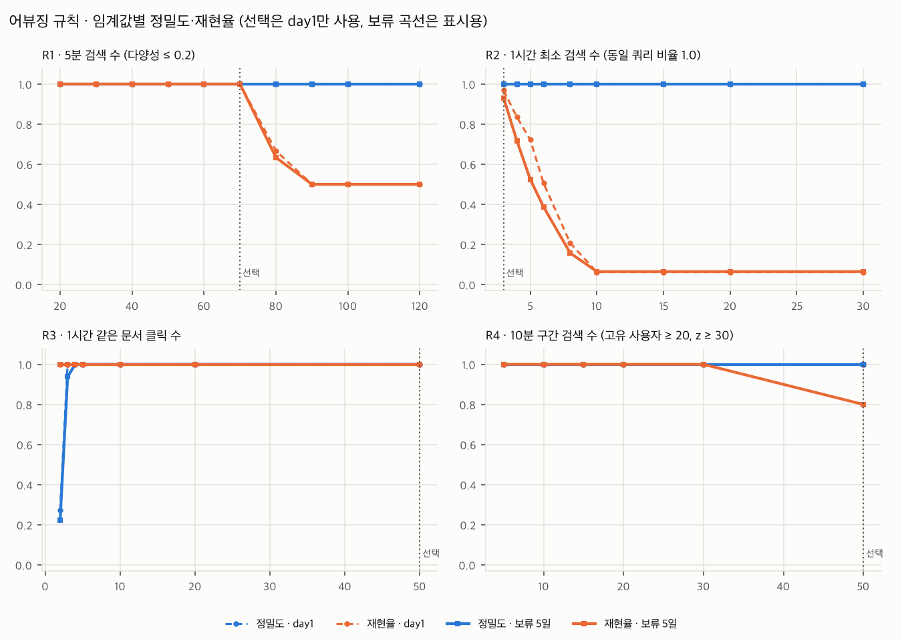

# search-log-pipeline

공개 검색 클릭 로그(MS MARCO ORCAS, 1,882만 쌍)를 실시간 이벤트로 재생해 **수집 → 검증·정제 → 적재 → 시간별 지표 → 어뷰징 탐지 → 관측**까지 잇는 로그 파이프라인 연습 프로젝트입니다.
- 장애를 **일부러 재현**하고, 대안을 같은 조건에서 측정해 비교한 기록을 함께 남겼습니다.
- 모든 수치는 실제로 실행해 측정한 값이며, 원자료는 `docs/results/*.json`에 있습니다.

```
ORCAS(tsv.gz) ─▶ 재생기(배속·늦은 도착·형식 오류·어뷰징 주입) ─▶ Kafka search-events (6 파티션, key=user_id)
                                                                     │
                                                                     ▼
                            Python 수집기: 검증·정규화, 200ms/5만 건 배치 ─▶ ClickHouse events (MergeTree)
                              │  오프셋을 데이터와 같은 INSERT로 기록(재시작 시 여기서 재개)      │
                              ├▶ search-events-dlq (거부 사유·원본 위치 헤더)                     │
                              └▶ /metrics ─▶ Prometheus ◀─ kafka-exporter(lag)                    │
                                                 │ 경보 규칙                                      │
                                                 ▼                                                ▼
                                              Grafana ◀──────────────────────────── Airflow 3 (워터마크 센서)
                                                                                     ├ hourly_metrics: 잠정 v1 → 확정 v2 → 늦은 도착 재확정
                                                                                     └ abuse_detection: 규칙 R1~R4 → abuse_detections
```

## 실험 요약
모든 장애와 어뷰징은 **의도적 주입**입니다. 측정 환경이 두 곳이라 수치를 서로 직접 비교하지 않습니다.
- **클라우드:** 2 vCPU · 7.8 GB (`docs/results/env_and_defaults.json`)
- **Mac:** Apple M4 10코어 · 24 GiB, Docker Desktop 11.67 GiB (`env_mac_m4.json`)

### 장애 재현 (1·2단계, 클라우드)
| | 재현한 문제 | 기준선 | 채택한 해결 | 결과 |
|---|---|---|---|---|
| [A](docs/troubleshooting/A-small-inserts.md) | 메시지 단위 INSERT | 초당 98건, 60초 뒤 lag 290,157건 | 크기·시간 배치(최대 5만 건/200ms) | 유입 초당 5,000건을 지연 p95 0.24초로 처리, 백로그 최대 초당 47,137건 |
| [B](docs/troubleshooting/B-crash-loss-duplicates.md) | 수집기 `kill -9` | 자동 커밋: 적재 직전 장애 시 유실 2,924~76,586건(장애 지점에 따라 유실 0·중복만 나기도 함) / 적재 후 커밋: 중복 62,984건 | 적재 데이터와 오프셋을 같은 INSERT로 기록하고 거기서 재개 + 정적 멤버십 | 장애 15회에서 유실 0·중복 0, 재시작 정지 44.7초 → 0.08초 |
| [C](docs/troubleshooting/C-late-events.md) | 늦게 도착한 이벤트 | 정시 집계 시 12개 시간 모두 누락(합계 548건) | 버전 재집계(+1분 잠정 → +15분 확정) — 3단계에서 구현 | +15분 이후 집계 누락 0건. 버전 재집계(+0→+15→+60분) 최종본이 12개 시간 모두 정답과 일치 |

### 지표·탐지·관측 (3·4단계, Mac)
| | 주제 | 방법 | 결과 |
|---|---|---|---|
| [지표 DAG](docs/02-metrics-dag.md) | 시간별 지표를 배속 재생 위에서 확정 | Airflow 3.3 DAG를 워터마크 센서로 진행: +1분 잠정 → +15분 확정 → +60분 늦은 도착 검사. 오프셋 경계로 확정 뒤 적재분을 셈 | 60배속 12시간: 잠정 누락 28건, **확정 누락 0건**. 확정 뒤 주입한 늦은 이벤트를 3개 시간 모두 감지·재확정. 최종 12개 시간 정답 일치 |
| [MV 재측정](docs/02-metrics-dag.md#5-mv-조회-비용-재측정-실험-c의-미검증-항목) | 실험 C의 미검증 항목 | 7일치(약 496만 건)에서 원본·MV·버전 표 조회를 서버 시간으로 비교 | 7일 시계열에서 MV(43.7ms)가 원본(40.4ms)보다 빠르지 않음. 미리 계산한 버전 표가 0.4~1.9ms → 원천은 원본, 조회는 버전 표 |
| [어뷰징 탐지](docs/03-abuse-detection.md) | 주입한 캠페인 탐지 | SQL 규칙 R1~R4. 임계값은 day1로만 정하고 다른 seed 5일에서 채점 | 보류 데이터 오탐 0. 단일 봇 30/30, distributed 계정 96.6%(합집합), R4 캠페인 8/10 |
| [관측](docs/04-observability.md) | 장애가 대시보드·경보에 보이는가 | Prometheus·Grafana. 평상시 값으로 임계값 결정 → 형식 오류 주입, 장애 지점 주입 + 60초 중단 | DLQ 경보 24.8초, 수집기 down 14.8초, lag 30.9초 뒤 발화. 장애 뒤에도 유실 0·중복 0 |

| A · 적재 방식별 lag | B · 장애 후 유실·중복 | C · 허용 지연과 누락 |
|---|---|---|
|  |  |  |

| 지표 DAG · 버전별 누락 | MV 조회 비용 | 어뷰징 규칙 정밀도·재현율 |
|---|---|---|
|  |  |  |

관측 대시보드(장애 주입 구간): [docs/img/D-dashboard.png](docs/img/D-dashboard.png)

### 예상과 다르게 나온 것
실험 중에 예상하지 못한 현상도 드러났고, 함께 기록했습니다.
- **`async_insert`:** 단일 소비자 구조에서 응답을 기다리면 처리량이 기준선의 1/7로 떨어졌습니다. 기다리지 않으면 1.8배 빨라졌지만 유입의 3.6%에 그쳤습니다(A).
- **Kafka 엔진 지연 측정:** `now64()`가 스트리밍 쿼리 시작 시각으로 고정돼 지연이 음수로 측정됐습니다(A).
- **중복 제거 토큰:** 비복제 테이블에서는 기본 설정상 무시됐고, 켜도 재시작 후 배치 경계가 달라져 효과가 없었습니다(B).
- **무작위 kill:** 좁은 위험 구간을 맞히지 못해 "중복 0"이라는 착시가 생겼고, 그래서 장애 지점 주입을 따로 만들었습니다(B).
- **정시 집계 누락의 원인:** 92%가 늦은 도착이 아니라 파이프라인 처리 지연이었습니다. 같은 설정으로 두 번 돌린 결과도 350건과 548건으로 달랐습니다(C).
- **MV가 7일치에서도 빠르지 않음:** 정확한 고유 사용자 상태(시간당 약 93KB)가 비용의 중심이었습니다(추정). 한 시간 조회는 그래뉼 단위로 MV 표 전체를 읽었고, `index_granularity=1`로 줄이자 2행만 읽었습니다(02 문서).
- **계정 단위 규칙이 분산 공격을 잡음:** 동일 쿼리 반복 규칙(R2)이 distributed 계정의 92.6%를 잡았습니다. 재생기의 정상 사용자가 같은 쿼리를 거의 반복하지 않는 가정 때문이라 실제 정밀도는 더 낮을 것으로 추정합니다(03 문서).
- **보수적 동률 선택의 대가:** day1에서는 R4 설정 144개 중 120개가 만점이었습니다. 가장 엄격한 값을 고르자 보류 데이터의 작은 캠페인 2개를 놓쳤습니다(03 문서).
- **시간대 없는 datetime:** clickhouse-connect가 시간대 없는 값을 호스트 로컬 시간(KST)으로 INSERT했습니다. 시험이 9시간 어긋남을 잡았습니다(02 문서).

## 문서
- [1단계 · 원천 데이터 점검과 재생 가정](docs/01-data-and-replay.md): CRLF, 빈 쿼리, 중복 270행 등 원본 품질 실측
- 장애 재현: [A](docs/troubleshooting/A-small-inserts.md) · [B](docs/troubleshooting/B-crash-loss-duplicates.md) · [C](docs/troubleshooting/C-late-events.md)
- [3단계 · 시간별 지표 DAG](docs/02-metrics-dag.md) · [3단계 · 어뷰징 탐지와 채점](docs/03-abuse-detection.md) · [4단계 · 관측](docs/04-observability.md)
- 원자료는 `docs/results/*.json`(Mac 측정분은 `_mac_m4` 접미사), 그림 스크립트는 `experiments/charts.py`입니다.

## 실행
```bash
uv venv --python 3.13 .venv && uv pip install --python .venv -r requirements.txt   # 또는 python -m venv + pip
scripts/download_orcas.sh                                    # 약 330MB, 크기·SHA-256 확인
export PYTHONPATH=src
.venv/bin/python -m slp.prepare                              # parquet 생성
.venv/bin/python -m slp.generator --hours 24 --labels data/labels_day1.json > data/day1.tsv
docker compose up -d --wait                                  # Kafka, ClickHouse (장애 재현 A·B·C 조건)
.venv/bin/python -c "from slp.infra import *; reset_topics(); create_events_table(ch(), 'events')"
.venv/bin/python -m slp.produce data/day1.tsv
.venv/bin/python -m slp.consume --instance-id ingest-0 --idle-exit 5     # --metrics-port 8000 으로 지표 노출
.venv/bin/pytest -q                                          # ClickHouse가 없으면 SQL 시험은 skip
```
- **3·4단계:** `docker compose --profile airflow --profile obs up -d --wait` 후 접속합니다.
  - Airflow: `http://localhost:8080`
  - Prometheus: `http://localhost:9090`
  - Grafana: `http://localhost:3000/d/slp-pipeline`
  - 로컬 전용 설정입니다(익명 접근, 기본 비밀번호는 환경변수로 변경).
- **실험 재현:** `cd experiments && PYTHONPATH=../src:. ../.venv/bin/python <스크립트>`
  - 장애 재현: `a_small_inserts.py`, `b_crash.py`, `b_restart.py`, `c_late.py`
  - 3·4단계: `c2_metrics_dag.py`, `c3_mv_scale.py`, `abuse_score.py load|tune|evaluate|hourly`, `d_observe.py`
  - 결과 JSON은 같은 이름이 이미 있으면 덮어쓰지 않고 시각을 붙인 새 파일에 저장합니다.

## 데이터와 작업 방식
- **데이터:** ORCAS는 비상업적 연구 목적으로만 쓸 수 있어 저장소에 포함하지 않습니다. 시각·세션·사용자·어뷰징은 재생기가 만든 가정이며, 가정은 [1단계 문서](docs/01-data-and-replay.md)에 적었습니다. CTR 등 클릭 지표는 이 가정에서 나온 값입니다.
- **AI 도구:** Claude(Anthropic)와 함께 작업했고, 해당 커밋에는 공동 작성자로 표기했습니다.
