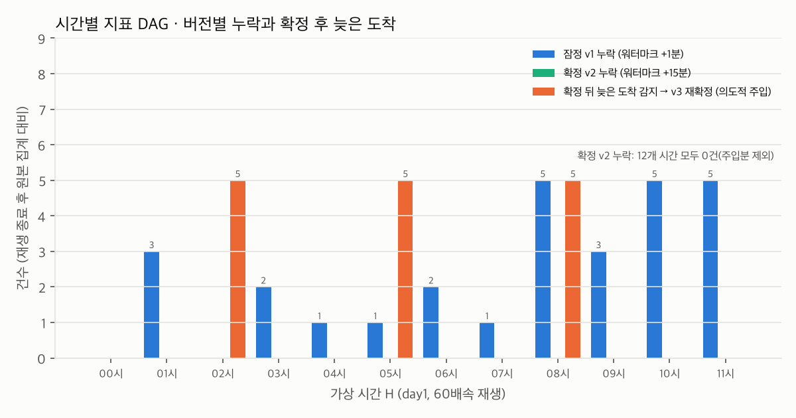
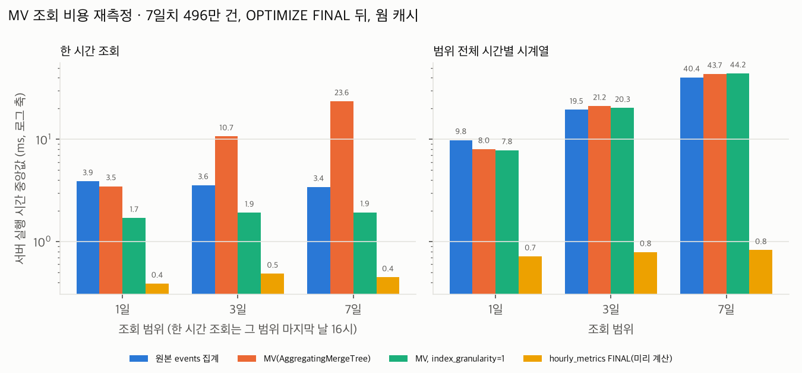

# 3단계 · 시간별 지표 DAG (워터마크 센서 + 버전 확정)

> 실험 C에서 측정으로 정한 설계(+1분 잠정 → +15분 확정, 확정 뒤 늦은 도착 감지·재확정)를 Airflow로 구현하고, 배속 재생 위에서 실제로 돌려 확인했습니다.
>
> - **측정 환경:** Apple M4(10코어) · RAM 24 GiB, Docker Desktop(CPU 10, 메모리 11.67 GiB), Kafka 3.8.0 · ClickHouse 24.8.14.39 · Airflow 3.3.2(standalone, LocalExecutor, Postgres 16 메타DB). 장애 재현 A·B·C의 클라우드(2 vCPU) 환경과 다르므로 수치를 직접 비교하지 않습니다.
>   - 환경 원자료는 `docs/results/env_mac_m4_resized.json`입니다. 처음 찍은 `env_mac_m4.json`(7.75 GiB)은 Docker 메모리를 12 GiB로 올리기 전의 값입니다.
>   - ClickHouse·Kafka 컨테이너가 2026-10-15T01:18:40Z에 시작해 재시작 없이 유지됐으므로, 이 문서의 실행은 모두 11.67 GiB에서 돌았습니다. 가장 이른 c2 1회차도 01:20Z 무렵 시작했습니다(1회차 검사 태스크 로그의 첫 줄이 01:22:03Z이고, H0의 +60분 검사는 재생 시작 약 2분 뒤에 돌기 때문. `metrics_dag_late_check_logs_mac_m4.json`).
> - **의도적 주입:** 확정 뒤 늦은 도착은 재생기 설정(최대 600초 지연)으로는 생기지 않습니다. 그래서 실험 스크립트가 일부러 이벤트를 넣었습니다(§4).
> - **원자료:** `docs/results/metrics_dag_mac_m4.json`(2회차, 본 결과), `metrics_dag_late_check_logs_mac_m4.json`(검사 태스크 로그 발췌), `metrics_dag_run1_partial_mac_m4.json`(1회차, §6), `mv_scale_mac_m4.json`·`mv_scale_run1_mac_m4.json`(§5).
> - **코드:** `src/slp/metrics.py`(SQL), `dags/hourly_metrics.py`(DAG), `experiments/c2_metrics_dag.py`, `experiments/c3_mv_scale.py`, 시험 `tests/test_metrics_sql.py`.

## 1. 구성

```
Kafka ─▶ 수집기 ─▶ ClickHouse events ─┬─ 워터마크 판정 (센서, 1초마다)
                                       └─ 시간 H 집계 ─▶ hourly_metrics_versions (모든 버전, MergeTree)
                                                       ├▶ hourly_metrics (ReplacingMergeTree(version)) ─▶ hourly_metrics_latest (FINAL 뷰)
                                                       ├▶ hourly_top_queries (상위 10개 쿼리)
                                                       └▶ hourly_late_checks (확정 후 늦은 도착 검사 기록)
```

DAG `hourly_metrics`의 태스크 순서는 다음과 같습니다. 시간 H는 run의 data interval [H, H+1h)입니다.

| 순서 | 태스크 | 진행 조건 | 하는 일 |
|---|---|---|---|
| 1 | `wait_watermark_1m` | 워터마크 ≥ H 끝 + 1분 | |
| 2 | `provisional` | | v1, `is_final=0` |
| 3 | `wait_watermark_15m` | 워터마크 ≥ H 끝 + 15분 | |
| 4 | `finalize` | | v2, `is_final=1`, 오프셋 경계 저장 |
| 5 | `wait_watermark_60m` | 워터마크 ≥ H 끝 + 60분 | |
| 6 | `late_after_final_check` | | 확정 뒤 적재된 H 이벤트 수를 셈. 0보다 크면 WARNING 로그 + 재확정(`max(version)+1`) |

## 2. 설계 결정

### 2-1. Airflow 3.3.2
- 다른 프로젝트(CareerRadar)와 주 버전을 맞췄습니다.
- Airflow 2는 2026-04-22에 지원이 끝났습니다(EOL). 근거: [공식 지원 버전 표](https://airflow.apache.org/docs/apache-airflow/stable/installation/supported-versions.html), 2026-10-15 확인.
- 로컬 실험용이라 `airflow standalone` 한 컨테이너에서 api-server, scheduler, dag-processor, triggerer를 함께 돌립니다. 운영 구성이 아닙니다.
- compose 프로필(`airflow`)로 분리했습니다. 기본 `docker compose up`은 지금처럼 Kafka와 ClickHouse만 띄우므로 실험 A·B·C의 재현 조건이 그대로입니다.

### 2-2. 시간 H 지정: data interval
- Airflow 3의 기본 cron 시간표는 data interval 길이가 0입니다. 컨테이너에서 `scheduler.create_cron_data_intervals = False`를 확인했습니다.
- 그래서 `CronDataIntervalTimetable("0 * * * *", timezone="UTC")`를 명시했습니다.
  - 실행된 run 12개(00:00~11:00 시작)의 data interval이 모두 정확히 3,600초였습니다.
  - 근거: `fact_checks_mac_m4.json`. 마지막 관측 실행 뒤의 메타DB이며, 두 DAG 모두 같았습니다.
- 가상 날짜(2026-01-05)가 과거이므로 `catchup=True`로 두면 run이 바로 만들어집니다.
  - `start_date`는 00:00, `end_date`는 11:00입니다. 실제로 run 12개가 만들어졌습니다.
  - 진행은 벽시계가 아니라 워터마크가 결정합니다. `max_active_runs=3`입니다.

### 2-3. 워터마크
**정의:** 수집기가 적재한 이벤트의 파티션별 `max(event_time)` 가운데 최솟값입니다.

**판정 쿼리:** 같은 뜻이면서 더 싼 형태로 씁니다.
```sql
SELECT uniqExact(kafka_partition) FROM events WHERE event_time >= {target}   -- 결과가 6(파티션 수) 이상이면 도달
```
"모든 Kafka 파티션에 target 이후 이벤트가 적재돼 있는가"를 묻는 쿼리입니다(비교는 파이썬에서 함).

**이렇게 정한 이유**
- **미래 시각 이상값:** 한 파티션에 미래 시각 이벤트가 들어와도 나머지 파티션이 따라오기 전에는 워터마크가 움직이지 않습니다. 시험에서는 p1에 27일 뒤 시각을 넣어 확인했습니다.
- **데이터 없는 파티션:** 그 파티션은 조건을 만족하지 못하므로 판정이 거짓입니다. 단순히 `GROUP BY` 결과의 최솟값을 쓰면 그 파티션이 빠져서 워터마크가 앞서 나갑니다.
- **형식 오류:** 수집기에서 이미 DLQ로 빠지므로 `events`에 없습니다.
- **같은 파티션 안의 순서:** 각 파티션을 읽는 수집기 프로세스는 하나입니다(이번 구성은 프로세스 1개가 6개 파티션을 모두 읽음). 수집기는 오프셋 순서대로 적재한 뒤 커밋합니다. 그래서 target 이후 이벤트가 보이면, 그 파티션에서 그보다 먼저 Kafka에 들어온 이벤트도 모두 적재된 상태입니다.

**비용:** 파티션 키와 정렬 키(`toStartOfHour(event_time)` 포함) 덕분에 target 이후가 들어 있을 수 있는 파트·그래뉼만 읽습니다. 2회차에서 판정 쿼리는 2,127회 실행됐습니다. 서버 시간은 p50 1 ms, p99 4 ms, 최대 16 ms였고(정수 ms), 읽은 행은 p50 0, p99 약 174였습니다.

**한계 (시험하지 않음)**
- 모든 파티션에 동시에 미래 시각 이상값이 들어오면 막지 못합니다.
- 유입이 끊긴 파티션이 있으면 워터마크가 멈춥니다(유휴 파티션 처리 없음). 센서 timeout(900초)으로 드러나게만 해 두었습니다.
- 재생기는 세션 이벤트를 900초 범위 안에서만 다시 정렬합니다. 그보다 긴 세션의 이벤트는 순서가 어긋날 수 있습니다. 이런 이벤트가 확정과 +60분 검사 사이에 도착하면 §2-4의 검사가 확정 후 늦은 도착으로 잡습니다. +60분 검사 뒤에 도착하면 잡지 못합니다.

### 2-4. 확정 후 늦은 도착: 오프셋 경계
- **경계 저장:** 확정 집계와 같은 SELECT에서 파티션별 최대 `kafka_offset`(`maxMap`)을 경계로 저장합니다.
- **늦은 도착 판정:** 나중에 "경계 밖 오프셋을 가진 H 이벤트"를 세면, 그것이 확정 뒤에 적재된 이벤트 수입니다.
- **두 번째 쿼리의 경계:** 같은 버전에서 이어지는 zero-click·상위 쿼리 계산도 **H의 검색 이벤트**에는 같은 경계 조건을 겁니다.
  - 다만 zero-click 판정에 쓰는 클릭 하위쿼리([H, H 끝+5분))에는 경계를 걸지 않았습니다. 그래서 첫 쿼리 뒤에 적재된 클릭이 반영될 수 있습니다. 완전한 스냅숏은 아닙니다(§8).
- **inserted_at 대신 오프셋을 쓴 이유:** `inserted_at > 확정 시각`으로 비교하면 시계 차이와 동시 적재의 영향을 받습니다. 오프셋 경계는 실험 B에서 채택한 "오프셋 재개"와 전제가 같습니다(파티션마다 기록자 하나, 오프셋 순서 적재).
- **보조 지표:** `max(inserted_at)` 기준 건수도 함께 기록했습니다.
  - 2회차에서 두 기준의 결과는 시간마다 같았습니다(주입한 시간 5/5, 나머지 0/0).
  - 수집기 INSERT 3,817회와 고유 `inserted_at` 3,817개가 1:1이었고, 여러 파트에 걸친 `inserted_at`은 0개였습니다.
- **주입 경로:** 주입 이벤트는 ClickHouse에 직접 넣지 않고 Kafka를 거쳤습니다(기록자가 하나라는 전제를 지키기 위해).

### 2-5. 저장과 읽기
- **`hourly_metrics`:** ReplacingMergeTree(version) ORDER BY hour. 읽는 쪽은 `hourly_metrics_latest` 뷰(FINAL)를 씁니다.
- **`hourly_metrics_versions`:** 병합되면 이전 버전이 사라지므로, 모든 버전을 MergeTree에 따로 남깁니다.
- **`hourly_top_queries`:** ORDER BY (hour, rank)에 항상 10행을 씁니다. 쿼리 문자열을 키로 쓰면 v1에만 있던 쿼리 행이 FINAL 뒤에도 남기 때문입니다.
- **시각 처리:** clickhouse-connect는 `DateTime64('UTC')` 값을 시간대 없는 UTC 시각으로 돌려줍니다. 그런데 시간대 없는 값을 INSERT하면 **호스트 로컬 시간으로 해석**합니다. KST 호스트에서 9시간이 어긋나는 것을 시험이 잡았고(`late_by_inserted_at` 7 ≠ 1, 작업 중 시험 실패로 확인), 쓰기 전에 항상 UTC를 명시하도록 고쳤습니다.
  - 같은 현상을 다시 재현해 `fact_checks_mac_m4.json`에 남겼습니다. 시간대 없는 2026-01-05 00:58:12가 2026-01-04 15:58:12(UTC)로 저장됐습니다.
  - 기존 수집기와 실험 스크립트는 처음부터 UTC를 명시한 값을 썼습니다(`validate.parse`, `datetime.now(timezone.utc)`).

### 2-6. 지표 정의
| 지표 | 정의 |
|---|---|
| searches / clicks | H 안의 `event_type`별 건수 |
| unique_users | `uniqExact(user_id)` |
| zero_click_searches | H 안의 검색 중, 같은 (session_id, qid)의 클릭이 [H, H 끝 + 5분)에 없는 검색 |
| ctr | clicks / searches (뷰에서 계산) |

- 재생기의 클릭 지연은 지수분포(평균 8초)입니다. +15분 확정은 5분 클릭 창에 늦은 도착(최대 600초)을 더한 시간을 덮습니다.
- 잠정 v1은 H 끝 직후의 클릭을 아직 보지 못하므로 zero-click이 크게 나올 수 있습니다.
- **CTR·클릭률·zero-click은 재생기의 가정(검색 뒤 클릭 확률 60%, 클릭 문서 균등 선택)에서 나온 값입니다. 실제 사용자 행동이 아닙니다.**

## 3. 실험 결과 (2회차, 60배속, day1 00~12시)

`experiments/c2_metrics_dag.py`로 실행했습니다. 조건은 다음과 같습니다.
- 재생: day1을 가상 시각 60배속으로 재생했습니다(가상 1시간 = 실제 1분).
- 재생 범위: 마지막 시간(11시)의 +60분 검사까지 워터마크가 가도록 13:10까지 보냈습니다.
- 수집기: 실험 A·B에서 채택한 기본값입니다.
- 정답: 재생이 끝난 뒤의 최종 적재본을 같은 정의로 집계한 값입니다(`metrics.aggregate`).

### 3-1. 실행
- run 12개와 태스크 72개(run당 6개)가 모두 **첫 시도에 성공**했습니다.
- 메모리 최댓값(docker stats, 47회 표본)은 Airflow 2.21 GiB, ClickHouse 2.16 GiB, Kafka 1.34 GiB, Postgres 0.07 GiB였습니다.

### 3-2. 버전별 누락
아래 표의 누락은 정답 대비 빠진 이벤트 수(검색+클릭)이고, **주입분은 빼고** 셌습니다. 워터마크 값은 계산 시점의 워터마크가 시간 끝보다 얼마나 지났는지(가상 분)입니다.

| H | 최종 이벤트 | v1 누락 | v1 워터마크 | v2 누락 | v2 워터마크 | 확정 후 늦은 도착 | 최신 버전 | 정답 일치 |
|---|---|---|---|---|---|---|---|---|
| 00시 | 18,151 | 0 | +2.40분 | 0 | +16.51분 | 0 | v2 | 예 |
| 01시 | 14,283 | 3 | +1.41분 | 0 | +16.25분 | 0 | v2 | 예 |
| 02시 | 11,486 | 0 | +2.63분 | 0 | +16.51분 | **5 (주입 5)** | v3 | 예 |
| 03시 | 9,685 | 2 | +1.66분 | 0 | +16.99분 | 0 | v2 | 예 |
| 04시 | 9,766 | 1 | +2.41분 | 0 | +16.08분 | 0 | v2 | 예 |
| 05시 | 11,214 | 1 | +2.03분 | 0 | +16.11분 | **5 (주입 5)** | v3 | 예 |
| 06시 | 13,891 | 2 | +2.34분 | 0 | +16.38분 | 0 | v2 | 예 |
| 07시 | 17,095 | 1 | +1.43분 | 0 | +16.48분 | 0 | v2 | 예 |
| 08시 | 22,858 | 5 | +1.76분 | 0 | +16.82분 | **5 (주입 5)** | v3 | 예 |
| 09시 | 27,177 | 3 | +1.84분 | 0 | +16.04분 | 0 | v2 | 예 |
| 10시 | 33,266 | 5 | +2.08분 | 0 | +16.18분 | 0 | v2 | 예 |
| 11시 | 37,379 | 5 | +2.36분 | 0 | +16.23분 | 0 | v2 | 예 |

- **최종 이벤트 합계:** 226,251건입니다. 실험 C의 00~12시 최종 적재 226,236건에 주입 15건을 더한 값과 같습니다.
- **잠정 v1:** 누락은 12개 시간 합계 28건이고, 10개 시간에서 났습니다. 완전도는 최저 99.978%입니다(8시, 주입분을 분자·분모에서 뺀 값. JSON의 `complete_pct`는 주입분을 포함함).
  - 빠진 이벤트는 재생기가 60~600초 늦게 내보낸 이벤트 가운데, 잠정 계산 시점(워터마크 +1.41~2.63분)까지 도착하지 않은 것으로 **해석**합니다. 이벤트별로 확인하지는 않았습니다.
- **확정 v2:** 누락은 12개 시간 모두 **0건**입니다.
- **정의 차이:** 실험 C의 "+1분 누락 36건"은 벽시계 기준(시간 마감 후 실제 1초)으로 잰 값입니다. 여기의 v1은 워터마크 기준이라 처리 중인 이벤트가 섞이지 않습니다. 정의와 환경이 달라 두 값을 비교하지 않습니다.



### 3-3. 배속 재생에서의 Airflow 지연
60배속에서는 실제 1초가 가상 1분입니다. 그래서 Airflow의 초 단위 지연이 가상 시각으로 분 단위가 됩니다.

| 항목 | 값 |
|---|---|
| 센서 성공 → 다음 태스크 시작 (실제 시간, 36회) | 중앙값 0.61초, 최대 0.96초 |
| 잠정 v1 계산 시점, 게이트(+1분) 대비 | 가상 0.58~1.87분 뒤(중앙값 1.30분) |
| 확정 v2 계산 시점, 게이트(+15분) 대비 | 가상 1.16~2.08분 뒤(중앙값 1.55분) |

- 지연에는 센서 poke 간격(1초 = 가상 1분)과 태스크 기동 시간이 들어 있습니다.
- 실제 속도(1배속)라면 같은 지연이 1초 안팎이라 무시할 수 있는 수준이라고 **추정**합니다. 1배속으로 재 보지는 않았습니다.
- 계산 시점의 워터마크를 행에 함께 저장하므로, 각 버전이 어디까지 본 값인지 확인할 수 있습니다.

## 4. 확정 후 늦은 도착: 의도적 주입 시험
- **주입 방법:** 2·5·8시마다 확정 v2가 기록된 직후(가상 시각 H 끝 + 16.7~17.3분), 그 시간의 event_time을 가진 검색 이벤트 5건을 Kafka로 보냈습니다.
  - 쿼리 문자열은 `slp very late injection test`이고, 주입한 event_id는 원자료에 있습니다.
  - 재생기의 늦은 도착 상한(600초)을 넘는 경로를 시험하기 위한 것입니다.
- **결과:** +60분 검사가 세 시간 모두 **5건**을 감지했습니다(`inserted_at` 기준도 5건).
  - WARNING 로그 `LATE_AFTER_FINAL`을 남기고 v3로 재확정했습니다. 로그 발췌는 `metrics_dag_late_check_logs_mac_m4.json`에 있습니다. 2회차의 검사 태스크 12개 가운데 경고는 3개(2·5·8시)였고, 나머지 9개는 INFO "확정 후 늦은 도착 없음"이었습니다. 1회차 로그도 같았습니다.
  - v3는 정답과 일치했습니다.
- **나머지 9개 시간:** 확정 후 늦은 도착이 0건이었고, 재확정도 일어나지 않았습니다.
- **알림:** 경보는 Airflow 태스크 로그에만 남깁니다. 외부로 보내는 알림은 4단계 관측에서 다룹니다.

## 5. MV 조회 비용 재측정 (실험 C의 미검증 항목)
실험 C(시간당 1~4만 건)에서는 MV 조회가 원본 집계보다 빠르지 않았습니다. 규모를 키워 다시 측정했습니다. 스크립트는 `experiments/c3_mv_scale.py`입니다.

**데이터와 적재**
- 재생기 seed 42로 가상 7일(`--hours 168`)을 만들었습니다. 유효 4,961,910건이며, 그중 7일 범위 안이 4,961,723건입니다.
  - 7일을 한 번에 만들면 캠페인 수가 늘어 난수를 쓰는 순서가 달라집니다. 그래서 첫날은 day1.tsv와 **같지 않습니다**.
- MV를 먼저 만든 별도 DB(`slp_scale`)에 Kafka → 수집기 경로로 적재했습니다. 운영 표 `slp.events`에는 MV를 붙이지 않았습니다.

**비교 대상(4가지)**

| 이름 | 방식 |
|---|---|
| 원본 | `events`를 그때그때 집계 |
| MV | `AggregatingMergeTree`, `uniqExactMerge`(실험 C와 같은 정의) |
| MV g1 | 같은 MV에 `index_granularity = 1`을 준 것. 1회차 결과를 보고 2회차에 추가함(아래 설명) |
| 버전 표 FINAL | DAG가 미리 계산해 둔 `hourly_metrics FINAL` |

네 방식 모두 168시간의 검색·클릭·고유 사용자 값이 서로 같은 것을 먼저 확인했습니다.

**측정 방법**
- 서버 측 실행 시간(`system.query_log`의 시작·종료 마이크로초 시각 차)을 썼습니다.
- 워밍업 1회 뒤 20회를 재고 네 방식을 번갈아 실행했습니다. 쿼리 캐시는 껐습니다.
- 페이지 캐시는 비우지 않았습니다(웜 캐시 기준).
- 측정 중에는 Airflow를 멈추고 Kafka와 ClickHouse만 실행했습니다.
- 표의 "읽은 행"은 query_log의 `read_rows`입니다.

**한 시간 조회** (그 범위 마지막 날 16시, 중앙값 / p90, ms)

| 상태 | 범위 | 원본 | MV | MV g1 | 버전 표 FINAL |
|---|---|---|---|---|---|
| 적재 직후 | 1일 | 3.53 / 3.90 (144,845행) | 3.67 / 4.09 (132행) | 1.93 / 2.05 (2행) | 0.64 / 0.71 (164행) |
| 적재 직후 | 3일 | 3.30 / 3.46 (172,032행) | 10.14 / 11.60 (132행) | 2.02 / 2.24 (2행) | 0.66 / 0.73 (164행) |
| 적재 직후 | 7일 | 3.14 / 3.89 (156,397행) | 7.97 / 9.30 (92행) | 1.79 / 2.29 (4행) | 0.68 / 0.77 (164행) |
| OPTIMIZE 뒤 | 1일 | 3.90 / 4.17 (131,072행) | 3.48 / 3.75 (169행) | 1.70 / 1.82 (2행) | 0.39 / 0.46 (168행) |
| OPTIMIZE 뒤 | 3일 | 3.56 / 4.07 (114,688행) | 10.71 / 12.01 (169행) | 1.92 / 2.34 (2행) | 0.48 / 0.58 (168행) |
| OPTIMIZE 뒤 | 7일 | 3.42 / 3.54 (114,688행) | 23.60 / 25.32 (169행) | 1.93 / 2.07 (2행) | 0.45 / 0.52 (168행) |

**범위 전체 시간별 시계열** (중앙값 / p90, ms)

| 상태 | 범위 | 원본 | MV | MV g1 | 버전 표 FINAL |
|---|---|---|---|---|---|
| 적재 직후 | 1일 | 11.59 / 12.78 (711,513행) | 8.32 / 8.79 (132행) | 8.18 / 9.33 (24행) | 0.97 / 1.06 (164행) |
| 적재 직후 | 3일 | 21.50 / 27.51 (2,129,011행) | 29.36 / 31.18 (132행) | 21.22 / 22.70 (72행) | 1.10 / 1.37 (164행) |
| 적재 직후 | 7일 | 45.74 / 51.77 (4,961,723행) | 35.28 / 42.91 (224행) | 38.13 / 42.64 (237행) | 1.86 / 2.41 (168행) |
| OPTIMIZE 뒤 | 1일 | 9.85 / 12.61 (711,513행) | 8.03 / 9.43 (169행) | 7.84 / 9.70 (24행) | 0.72 / 1.11 (168행) |
| OPTIMIZE 뒤 | 3일 | 19.48 / 25.89 (2,129,011행) | 21.21 / 24.78 (169행) | 20.29 / 21.55 (72행) | 0.79 / 0.84 (168행) |
| OPTIMIZE 뒤 | 7일 | 40.44 / 49.44 (4,961,723행) | 43.71 / 51.85 (169행) | 44.19 / 52.71 (168행) | 0.82 / 0.87 (168행) |



**관측**
- **범위 시계열:** MV는 원본보다 빠르기도 하고 느리기도 했습니다. 두 회차 모두 같은 방향이었습니다.
  - MV가 빨랐던 경우: 적재 직후 1·7일과 OPTIMIZE 뒤 1일(2회차 기준 18~28% 빠름)
  - MV가 느렸던 경우: 3일 범위와 OPTIMIZE 뒤 7일(2회차 기준 8~37% 느림)
  - 어느 쪽이든 원본과 같은 자릿수였습니다. 범위 시계열의 원본·MV·MV g1 전체가 7.8~45.7 ms였고, 기본 MV만 보면 8.0~43.7 ms였습니다.
  - MV는 읽은 행이 수십~수백 개뿐인데도 이 정도 시간이 걸렸습니다(MV·MV g1 24~237행, 기본 MV만 132~224행).
  - MV 표는 169행에 디스크 15.7 MB로, 행당 약 93 KB입니다. 원본 `events`는 496만 행에 435.6 MB입니다.
  - 따라서 비용 대부분이 시간마다 저장된 정확한 고유 사용자 집합(`uniqExactState`)을 풀어 합치는 데 든다고 **추정**합니다. 근사 함수(`uniq`, `uniqCombined`)로 바꾼 변형은 측정하지 않았습니다.
- **한 시간 조회, 기본 MV:** 조회 대상이 뒤쪽 날짜일수록 느려졌습니다(OPTIMIZE 뒤 3.5 → 10.7 → 23.6 ms).
  - 이때 읽은 행은 항상 169개, 즉 MV 표 전체였습니다. 그래뉼(기본 8,192행) 단위로 읽기 때문입니다.
- **한 시간 조회, MV g1:** 그래뉼을 1행으로 줄이자 읽은 행이 2개(적재 직후 7일은 4개)로 줄었고, 범위와 무관하게 1.7~2.0 ms가 됐습니다.
  - 그래뉼이 시간 행 여러 개를 함께 읽게 만든다는 1회차의 추정과 맞는 결과입니다.
  - 기본 MV가 표 전체(169행)를 읽은 것은 OPTIMIZE 뒤의 값입니다. 적재 직후 7일에서는 224행 중 92행을 읽었습니다.
  - 다만 기본 MV에서 같은 169행을 읽는데도 위치에 따라 시간이 다른 이유는 분리하지 않았습니다.
- **버전 표:** 미리 계산해 둔 `hourly_metrics FINAL`이 모든 경우 가장 빨랐습니다(0.39~1.86 ms). 범위 시계열에서 원본·MV·MV g1보다 약 8~54배 빨랐습니다. 시간당 한 행에 작은 숫자 열만 있기 때문입니다.
- **1회차와 비교:** 1회차(`mv_scale_run1_mac_m4.json`, MV g1 없음)의 OPTIMIZE 뒤 중앙값입니다. 값은 1·3·7일 순입니다.
  - 시계열 6칸은 두 회차의 MV·원본 순서가 같았습니다.
  - 한 시간 조회의 1일 칸은 회차마다 순서가 뒤집혔습니다(1회차 MV 5.06 > 원본 4.59, 2회차 MV 3.48 < 원본 3.90).

  | 조회 | 원본 | MV | 버전 표 |
  |---|---|---|---|
  | 한 시간 | 4.59 · 4.27 · 3.74 ms | 5.06 · 12.31 · 25.27 ms | 0.66 · 0.69 · 0.66 ms |
  | 시계열 | 12.30 · 22.05 · 41.55 ms | 9.66 · 23.99 · 48.02 ms | 0.81 · 0.83 · 0.86 ms |

**결정 (실험 C §5 갱신)**
- 시간별 지표의 **원천은 원본 `events`로 둡니다.**
  - DAG와 같은 함수(`compute_hour`: 쿼리 4개 + INSERT 3회)로 168시간을 계산하는 데 5.8초, 시간당 약 35 ms가 걸렸습니다(c3, 클라이언트 측).
    - 이는 DAG 비용에서 차지하는 비중이 작습니다. c2에서 계산 태스크의 시작~종료는 잠정이 중앙값 0.48초, 확정이 0.36초였습니다.
    - 그래서 태스크 시간 대부분은 집계 밖의 비용(태스크 기동, 클라이언트 연결 등)이라고 **추정**합니다. 태스크 안의 시간을 나눠 재지는 않았습니다.
  - 확정 후 늦은 도착을 셀 오프셋 경계를 같은 스캔에서 잡을 수 있습니다.
- **대시보드와 조회는 버전 표(`hourly_metrics_latest`)를 읽습니다.**
- 이 규모와 이 정의(정확한 고유 사용자)에서는 **MV를 채택하지 않습니다.** MV는 원본 대비 이득이 상태·범위에 따라 엇갈렸습니다. 또 2회차의 모든 조회에서 원본·MV·MV g1이 버전 표보다 2.6~53.6배 느렸기 때문입니다.
  - 데이터가 훨씬 커지거나 고유 사용자를 근사값으로 바꾸면 결론이 달라질 수 있습니다. 측정하지는 않았습니다.

## 6. 재현성과 1회차
- **1회차:** 재생과 DAG는 끝까지 돌았지만, 결과 수집 단계에서 스크립트 오류로 중단됐습니다(ClickHouse 24.8 `system.query_log`에 없는 열 `event_time64`를 사용).
  - 재생 시작 시각(벽시계)·주입 시각·docker stats는 메모리에만 있다가 사라졌습니다. 그래서 가상 시각으로 환산한 지표는 없습니다.
  - 중단 직후 ClickHouse와 Airflow 메타DB를 직접 조회한 값을 `metrics_dag_run1_partial_mac_m4.json`에 남겼습니다.
- **1회차 조회값과 2회차 비교**
  - 공통: 태스크 72개(6종 × 12)가 모두 첫 시도에 성공했고(1회차는 dag_run 상태를 따로 기록하지 않음), 확정 v2 누락은 0건(주입분 제외)이었습니다. 주입 시간 세 곳 모두 5건을 감지해 재확정했고, 12개 시간 모두 정답과 일치했습니다.
  - 다른 점: 잠정 v1 누락은 1회차 27건(11개 시간), 2회차 28건(10개 시간)이었습니다.
- **조치:** 재생 중에만 얻을 수 있는 값은 수집 전에 `data/c2_raw_state.json`으로 먼저 저장하고, `--collect-from`으로 수집만 다시 할 수 있게 고쳤습니다.

## 7. 시험
`tests/test_metrics_sql.py`는 파티션 3개짜리 고정 데이터로 다음을 검증합니다.
- 워터마크가 미래 시각 이상값에 밀리지 않는다.
- 데이터 없는 파티션이 있으면 워터마크 판정이 거짓이다.
- v1과 v2의 값과 오프셋 경계가 맞다.
- 확정 후 늦은 도착을 감지해 재확정(v3)하고, 새 이벤트가 없으면 재확정하지 않는다.
- 상위 쿼리 표가 10행이다.

ClickHouse가 없으면 skip합니다.

로직을 일부러 깨뜨렸을 때 시험이 실패하는지도 확인했습니다(작업 중 1회, 기록 파일 없음). 세 경우 모두 실패했습니다.
- 워터마크 판정을 "파티션 1개 이상"으로 바꿨을 때
- 늦은 건수를 0으로 고정했을 때
- 상위 쿼리 10행 채우기를 뺐을 때

## 8. 한계
- **재생 범위:** 하루 중 12시간만 확인했습니다. 재생은 두 번 했고, 1회차는 수집 단계에서 중단됐습니다(§6). 날짜 경계(00시)를 넘는 시간은 시험하지 않았습니다.
- **zero-click의 클릭 쪽 경계:** 클릭 하위쿼리에는 오프셋 경계가 없습니다. 그래서 확정 뒤에 다음 시간 첫 5분의 클릭이 늦게 도착하면 확정값의 zero-click과 어긋날 수 있습니다. 이 클릭은 H 이벤트가 아니므로 `late_after_final`이 세지 않고, 재확정도 일어나지 않습니다. 이번 실행에서는 12개 시간 모두 최종값이 정답과 일치해 영향이 없었습니다.
- **알림:** 확정 후 늦은 도착 경보는 로그로만 남깁니다(→ 4단계).
- **수집기:** 하나일 때만 확인했습니다. 수집기가 여럿이어도 파티션마다 기록자가 하나라면 오프셋 경계는 성립한다고 **추정**합니다. 시험하지는 않았습니다.
- **+60분 이후 도착:** +60분 검사 뒤에 도착하는 이벤트는 이 DAG가 다시 보지 않습니다. 일 단위 대조 같은 별도 점검이 필요합니다(미구현).
