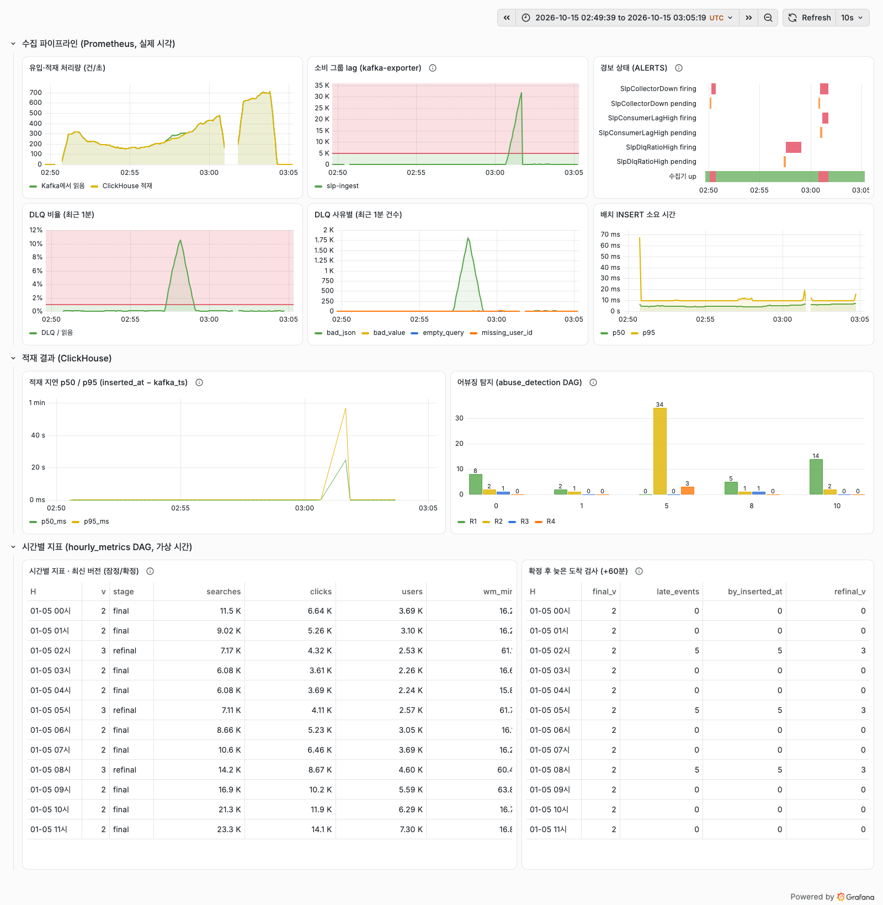

# 4단계 · 관측: Prometheus·Grafana와 경보

> 수집기 지표, 소비 그룹 lag, 적재 지연, 시간별 지표 상태, 어뷰징 탐지를 한 대시보드에서 볼 수 있게 했습니다. 그리고 **의도적으로 장애를 주입**해 경보가 실제로 발화하는지 확인했습니다.
>
> - **측정 환경:** Apple M4 · Docker Desktop(CPU 10, 메모리 11.67 GiB, `env_mac_m4_resized.json`: ClickHouse·Kafka 컨테이너가 01:18:40Z에 시작해 재시작 없이 유지됐고 이 문서의 실행은 모두 그 뒤). Kafka 3.8.0 · ClickHouse 24.8 · Airflow 3.3.2 · kafka-exporter v1.10.0 · Prometheus v3.15.0 · Grafana 13.2.4.
> - **원자료**
>   - `docs/results/observability_calibration_mac_m4.json`: 장애 없는 보정 실행
>   - `observability_mac_m4.json`: 장애 주입 실행
>   - `observability_latency_mac_m4.json`: 적재 지연 분해
> - **설정:** `observability/`(Prometheus 설정·경보 규칙, Grafana 데이터소스·대시보드 프로비저닝), `docker-compose.yml`의 `obs` 프로필.
> - **코드:** `src/slp/consume.py`(`--metrics-port`), `experiments/d_observe.py`.

## 1. 구성

```
수집기(호스트, --metrics-port 8000) ──scrape 5초──▶ Prometheus ──▶ 경보 규칙(pending → firing)
kafka-exporter ─(kafka:19092)─────────scrape 5초──┘        │
                                                          ▼
ClickHouse(events, hourly_metrics_*, abuse_detections) ─▶ Grafana(대시보드 프로비저닝)
```

| 구성 요소 | 역할 | 비고 |
|---|---|---|
| 수집기 지표 | 아래 표 참고 | `--metrics-port`를 줄 때만 켜짐(기본 0). 실험 A의 다중 소비자가 같은 포트를 쓰다 충돌하지 않게, 기존 실험의 동작도 바뀌지 않게 하기 위함 |
| kafka-exporter | 소비 그룹 lag(커밋된 오프셋 기준) | 수집기가 죽으면 수집기 자신의 지표도 사라집니다. 그래서 lag는 **밖에서** 잽니다 |
| Prometheus | 수집·경보 평가 | 5초 간격. Alertmanager는 두지 않았습니다. 경보는 **발화만** 하고 외부로 보내지 않습니다 |
| Grafana | 대시보드 | 데이터소스와 대시보드를 파일로 프로비저닝. ClickHouse 플러그인은 아래 설명 |

**수집기 지표**
- 카운터: `slp_consumed_total`, `slp_inserted_rows_total`, `slp_dlq_total{reason}`, `slp_insert_errors_total{code}`
- 히스토그램: `slp_insert_seconds`, `slp_batch_rows`
- 게이지: `slp_last_insert_timestamp_seconds`
- 메시지마다가 아니라 배치마다 갱신합니다.

**ClickHouse 플러그인 설치:** `grafana-clickhouse-datasource@4.22.1`을 `GF_PLUGINS_PREINSTALL_SYNC`로 버전을 고정해 설치합니다. Grafana 문서는 이 방식이 "Grafana 시작 전에 설치되며 프로비저닝과 함께 쓸 때 유용"하다고 설명합니다([설정 문서](https://grafana.com/docs/grafana/latest/setup-grafana/configure-grafana/)). 반면 `GF_PLUGINS_PREINSTALL`은 비동기로 설치합니다.

**호스트 수집기 수집:** 수집기는 호스트에서 127.0.0.1:8000에 바인딩합니다. Prometheus는 `host.docker.internal`(compose `extra_hosts: host-gateway`)로 수집합니다. Docker Desktop(Mac)에서 수집 대상이 up인 것을 확인했습니다.

**실행:** `docker compose --profile airflow --profile obs up -d --wait`. 그다음 수집기를 `--metrics-port 8000`으로 띄웁니다. 대시보드 주소는 `http://localhost:3000/d/slp-pipeline`입니다(로컬 전용 익명 Viewer).

**대시보드 패널**

| 묶음 | 패널 |
|---|---|
| 수집 파이프라인(Prometheus, 실제 시각) | 유입·적재 처리량, 소비 그룹 lag, 경보 상태(ALERTS·수집기 up), 1분 DLQ 비율, DLQ 사유별 건수, 배치 INSERT p50/p95 |
| 적재 결과(ClickHouse) | 적재 지연 p50/p95(`inserted_at − kafka_ts`), 어뷰징 탐지 건수(가상 시간·규칙별) |
| 시간별 지표(가상 시간) | 최신 버전 표(버전·잠정/확정·계산 시점 워터마크), 확정 후 늦은 도착 검사 |

- 적재 지연은 Kafka 메시지 시각(생산자, 호스트 시계)과 ClickHouse 적재 시각(컨테이너 시계)의 차이입니다. 두 시계의 차이는 0.84\~1.46 ms로 측정됐습니다. 관측 실행과 같은 Docker 부팅에서 잰 값은 −1.46 ms(`env_mac_m4_resized.json`, 04:23 UTC)이고, 그 전 부팅에서 잰 값은 −0.84 ms(`env_mac_m4.json`)입니다. 관측 실행 중에 잰 값은 아닙니다.

## 2. 경보 규칙과 임계값 근거

| 경보 | 식 | 지속 | 임계값 |
|---|---|---|---|
| `SlpConsumerLagHigh` | `sum by (consumergroup)(kafka_consumergroup_lag{topic="search-events", consumergroup="slp-ingest"})` | 15초 | > 5,000건 |
| `SlpDlqRatioHigh` | `sum(increase(slp_dlq_total[1m])) / sum(increase(slp_consumed_total[1m]))` | 15초 | > 1% |
| `SlpCollectorDown` | `up{job="collector"} == 0` | 10초 | |

**임계값을 정한 순서:** 경보 규칙 파일에는 값이 있어야 하므로 잠정값(5,000건·1%)을 먼저 넣었습니다. 그다음 장애 없는 보정 실행으로 평상시 값과의 여유를 확인하고, 그대로 확정했습니다. 보정 결과를 보고 값을 새로 정한 것은 아닙니다.
- **보정 실행:** day1 00\~13:10을 60배속으로 재생했고, 지표 DAG와 탐지 DAG도 함께 돌렸습니다.
- **평상시 최댓값(5초 간격 표본)**
  - lag: 150건(175개 표본)
  - 1분 DLQ 비율: 0.085%(167개). 재생기의 형식 오류 비율은 0.05%입니다.
  - 읽기 처리량: 712건/초
  - 배치 INSERT p95: 0.067초
- **임계값과 여유**
  - lag 5,000건은 평상시 최대의 약 33배입니다. 가상 10시(시간당 약 3.3만 건, 실제 초당 약 550건)에 수집기가 60초 멈추면 lag는 약 3만 건이 될 것으로 계산했습니다.
  - DLQ 1%는 보정 실행의 평상시 최대의 약 12배입니다. 장애 주입 실행의 첫 장애 전 구간 최댓값은 0.111%로, 이 기준이면 약 9배입니다.
- **보정 실행의 결과**
  - lag와 DLQ 경보는 한 번도 발화하지 않았습니다.
  - 유실 0, 중복 0이었고, DLQ 132건은 정답의 거부 건수와 같았습니다.
  - 두 DAG의 run 24개가 모두 성공했고, 시간별 지표 12개가 모두 정답과 일치했습니다.
  - 수집기 down 경보는 1건 발화했습니다. 실행 시작 전 수집기가 아직 뜨지 않은 구간에서 난 것으로, 실제 상태와 맞는 경보입니다.
- **알려진 한계:** lag 경보는 운영 소비 그룹 `slp-ingest`로 한정했습니다. 실험마다 다른 그룹을 만들기 때문에, 한정하지 않으면 남은 그룹이 경보를 울릴 수 있습니다.

## 3. 장애 주입 실행 (모두 의도적 주입)
`experiments/d_observe.py`로 day1을 60배속 재생하면서 두 DAG를 함께 돌리고, 아래 장애를 넣었습니다.

| 시점(재생 시작 기준, 실제 초) | 가상 시각 | 주입 |
|---|---|---|
| +390.0 ~ +450.0 | 06:30 ~ 07:30 | 잘린 JSON(bad_json) **1,800건**(초당 30건 × 60초)을 Kafka에 직접 넣음 |
| +600.0 | 10:00 | 수집기 정상 종료 → **실험 B의 장애 지점 주입**: `--failpoint-prob 1 --failpoint-where after`로 다시 띄움. 첫 배치(223행)를 적재한 직후, 커밋 전에 스스로 SIGKILL함(로그 `FAILPOINT after_insert_before_commit`, 종료 코드 −9) |
| +600.5 ~ +660.5 | | **60초 동안 재시작하지 않음**(생산은 계속) |
| +660.5 | 11:00 | 같은 소비 그룹·정적 멤버십으로 재시작(ClickHouse 오프셋 재개). 첫 메시지까지 0.08초 |

확정 후 늦은 도착(2·5·8시 각 5건)도 3단계와 같은 방식으로 주입했습니다.



> 스크린샷은 실행 뒤 헤드리스 Chrome으로 찍었습니다(구간 `2026-10-15 02:49:39~03:05:19 UTC`). 실행 뒤 대시보드를 다듬었습니다(경보 패널을 상태 타임라인으로, DLQ 사유 패널을 비누적으로, 표 크기·열 조정). 그다음 **같은 구간의 저장된 데이터**(Prometheus·ClickHouse)로 다시 그렸습니다. 실험을 다시 돌린 것은 아닙니다.

### 3-1. 경보 반응
Prometheus `ALERTS` 시계열(5초 간격)과 2초 간격 폴링 기록으로 쟀습니다. 시각은 재생 시작 기준(실제 초)이고, 괄호 안은 장애 시작으로부터 걸린 시간입니다. 폴링 간격 때문에 pending·firing 시각에는 약 2초의 해상도 한계가 있습니다(Prometheus의 수집·평가 간격은 5초).

| 장애 | 경보 | pending | firing | 마지막 firing 표본 |
|---|---|---|---|---|
| 형식 오류 주입(+390.0 시작) | `SlpDlqRatioHigh` | +400.8 (10.8초) | **+414.8 (24.8초)** | +500 (주입 종료 50초 뒤, 폴링에서는 +503.1까지 보임) |
| 수집기 SIGKILL(+600.5) | `SlpCollectorDown` | +605.3 (4.8초) | **+615.3 (14.8초)** | +660 |
| 〃 | `SlpConsumerLagHigh` | +615.3 (14.8초) | **+631.4 (30.9초)** | +660 |

- **DLQ 경보:** 1분 DLQ 비율이 최대 **10.55%**(+450)까지 올랐습니다. 지표의 사유별 증가량을 보면 주입한 메시지는 `bad_json`으로 집계됐습니다(주입 종료 시점 1분 증가량 1,808.8건, `observability_latency_mac_m4.json`에 옮겨 둠).
  - 경보는 주입이 끝난 뒤에도 약 50초 더 firing이었습니다. 1분 창(`increase(...[1m])`)이 주입 구간을 벗어나는 데 걸린 시간입니다.
- **수집기 장애**
  - lag가 최대 **31,919건**(+660)까지 쌓였습니다.
  - 재시작 뒤 5초 표본에서 1,000건 미만으로 내려갔습니다(+665, 재시작 4.5초 뒤).
  - 처리량 패널의 30초 이동 평균에는 따라잡기 속도가 그대로 드러나지 않습니다.
- **경보 해제 시각:** Prometheus에는 'resolved' 상태가 없어 마지막 firing 표본으로 판단했습니다.
  - 실험 스크립트의 폴링 기록은 경보가 하나도 없는 폴링을 남기지 않습니다. 그래서 그 기록의 `gone_at` 값은 쓰지 않았습니다(스크립트 한계).
- **수집기 down 경보 1건 추가:** 이 실행에도 재생 시작 전(-35\~-5초)에 1건이 있었습니다. 앞선 보정 실행의 수집기가 끝나고 이번 수집기가 뜨기 전의 공백에서 난 것입니다.

### 3-2. 적재 지연 (`inserted_at − kafka_ts`)
| Kafka 도착 시점 | 이벤트 | p50 | p95 | 최대 |
|---|---|---|---|---|
| 첫 장애 전(+0 ~ +390) | 81,015 | 128 ms | 222 ms | 632 ms |
| 수집기가 멈춘 동안(+600 ~ +660.5) | 33,592 | 29.3초 | 57.3초 | 60.6초 |
| 재시작 뒤(+660.5 ~ 끝) | 85,584 | 124 ms | 217 ms | 624 ms |

- 분위수는 `quantileExact`로 계산했습니다(`experiments/d_latency.py`). 처음에는 근사 `quantile`을 썼는데, 정확값과 비교하면 평상시 구간은 1\~2 ms, 수집기가 멈춘 구간은 p50·p95 기준 약 0.2\~0.3초 차이가 났습니다(p50 29.05 → 29.33초). 근사값은 커밋 `da33094` 시점의 `observability_latency_mac_m4.json`에 있고, 이후 같은 파일을 정확값으로 갱신했습니다.
- 60배속이라 가상 1시간이 실제 1분입니다. 따라서 평상시 지연 0.13\~0.22초는 가상 시각으로 8\~13초에 해당합니다.

### 3-3. 장애 뒤 정확성
| 항목 | 결과 |
|---|---|
| 유효 이벤트(보낸 274,898줄 중 정답 274,766 + 늦은 도착 주입 15) | 적재 274,781행 = 고유 event_id 274,781, **유실 0 · 중복 0** |
| DLQ | 1,932건 = 정답 거부 132 + 주입 1,800 |
| DAG | hourly_metrics와 abuse_detection 각 12개 run 모두 성공 |
| 시간별 지표 | 최신 버전 12개 시간 모두 정답과 일치. 2·5·8시는 확정 후 늦은 도착 5건씩 감지 → v3 |
| 어뷰징 탐지 | DAG 결과(R1 29, R2 40, R3 2, R4 3건)가 같은 표에 오프라인으로 돌린 결과와 같음 |

- 장애 지점 수집기는 커밋 전에 죽었습니다. 그런데도 중복이 없었던 것은 실험 B에서 채택한 ClickHouse 오프셋 재개가 그대로 동작했기 때문입니다.
- 이 실행에서는 커밋 전 장애 1회만 확인했습니다.

## 4. 한계와 발견
- **DLQ 유실 가능성(코드 분석, 관측되지 않음, 시험하지 않음)**
  - 수집기는 INSERT → (장애 지점) → DLQ 전송 flush → 커밋 순서로 동작합니다. 재시작 위치는 ClickHouse에 적재된 **유효 행**의 파티션별 최대 오프셋 + 1입니다.
  - 그래서 적재 직후 죽으면 문제가 될 수 있습니다. 같은 배치의 거부 메시지 가운데 ① 그 파티션의 마지막 유효 행보다 **앞 오프셋**이고 ② DLQ 프로듀서 버퍼에서 아직 전송되지 않은 것은 다시 읽히지 않아 **유실될 수 있다**고 **추정**합니다.
    - 마지막 유효 행보다 뒤 오프셋인 거부 메시지는 다시 읽힙니다. 죽기 전에 이미 보냈다면 DLQ에 중복으로 들어가고, 못 보냈다면 한 번만 들어갑니다.
    - DLQ 프로듀서는 `linger.ms=50`이라, 위험한 것은 대체로 죽기 직전 약 50 ms 안에 만든 메시지와 전송 중인 메시지로 좁습니다(추정).
  - **이번 실행에서 본 것:** DLQ 토픽은 1,932건이었습니다. 장애 전 수집기 1,880건과 재시작 뒤 수집기 51건을 빼면 1건이 남습니다(`observability_latency_mac_m4.json`, 차감 계산. 장애 지점 수집기는 SIGKILL로 끝나 자기 건수를 출력하지 못함).
    - 이 1건은 장애 지점 수집기가 거부 메시지 1건을 처리해 SIGKILL 전에 이미 보낸 것이라고 **추정**합니다.
    - 토픽 건수(1,932 = 정답 거부 132 + 주입 1,800)는 맞았지만, 메시지 단위로 대조한 것은 아닙니다. 따라서 "유실·중복이 없었다"가 아니라 "건수 차이가 관측되지 않았다"입니다.
  - 실험 B 문서는 DLQ를 "at-least-once"(중복 가능)라고만 적었습니다. 이 경로에 대한 대응(DLQ 전송을 INSERT 전에 flush하거나, 거부 메시지의 오프셋도 함께 기록)은 아직 구현하지 않았습니다.
- **경보 전송 없음:** Alertmanager를 두지 않아 경보는 Prometheus와 대시보드에만 보입니다.
- **Airflow 관측 없음:** Airflow 자체 지표(StatsD/OTel)는 수집하지 않았습니다. DAG 상태는 ClickHouse 결과 표로만 봅니다.
- **장애 종류:** 단일 수집기·단일 브로커 환경에서 장애 두 종류만 시험했습니다. 브로커 장애, ClickHouse 장애, 네트워크 분할은 시험하지 않았습니다.
- **임계값 일반화:** 경보 임계값은 60배속 재생의 유입량(최대 초당 약 700건) 기준입니다. 실제 유입량이 다르면 다시 정해야 합니다.
